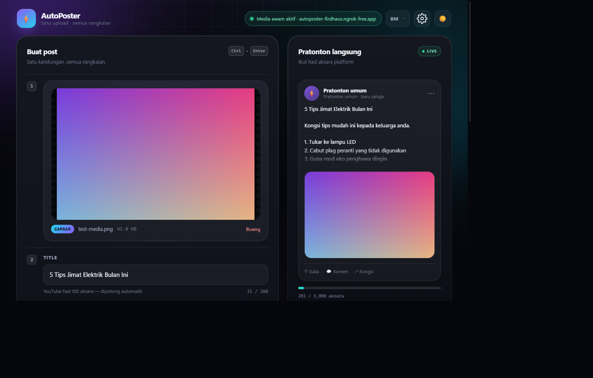
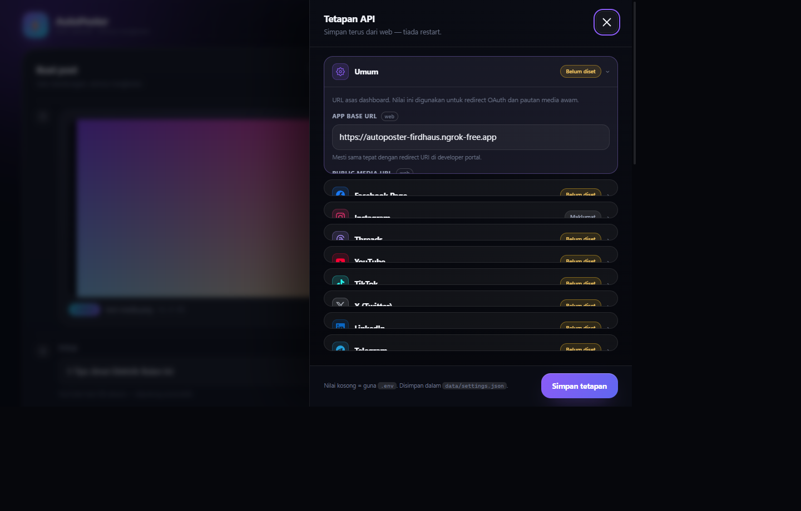

# ⚡ AutoPoster

**Satu post · semua platform** — Facebook Page, Instagram, Threads, YouTube, TikTok, X, LinkedIn, Telegram.

<p align="center">
  
</p>

**Bahasa / Language / 语言:**
[🇲🇾 Bahasa Melayu](#-bahasa-melayu) ·
[🇬🇧 English](#-english) ·
[🇨🇳 中文](#-中文)

---

## 🇲🇾 Bahasa Melayu

### Mula pantas (Windows)

1. Muat turun **`AutoPoster-win-x64.zip`** dari tab **[Releases](../../releases)**.
2. Extract ke folder tetap, contoh `C:\AutoPoster`.
3. Double-click **`AutoPoster.exe`** — browser terbuka automatik di `http://localhost:3000`.
4. Klik ikon **⚙️** dan isi API key platform.
5. Klik **sambung** untuk login setiap platform (Telegram guna token bot sahaja).
6. Lepas media, isi title/description, pilih platform → **Post sekarang**.

> **Tiada Node.js diperlukan** untuk versi `.exe` — semuanya dibungkus dalam satu binary.

### Auto-start bila log masuk Windows

Jalankan **`install-autostart.cmd`** sekali. AutoPoster akan mula tersembunyi setiap kali
anda log masuk dan browser terbuka sendiri. Batalkan dengan **`uninstall-autostart.cmd`**.

### Versi online (demo)

**https://autoposter-firdhaus.ngrok-free.app**

- Hanya hidup apabila PC host dihidupkan dan tunnel ngrok berjalan.
- Halaman amaran ngrok mungkin muncul sekali — klik **Visit Site**.
- ⚠️ **Tiada password.** Kongsi hanya dengan orang yang dipercayai. Jangan simpan token
  sebenar pada instance awam ini.
- Untuk kegunaan ramai, setiap pengguna patut jalankan AutoPoster sendiri.

### Host sendiri (Node.js 20+)

```bash
npm start          # atau:  node server.cjs
```

Semua dependency sudah dibundel — tiada `npm install` diperlukan.

Untuk akses awam: `ngrok http 3000`, kemudian masukkan URL `https://…` ke
**⚙️ Tetapan → Public Media URL**.

### Tetapan platform

| Platform | Yang diperlukan |
|---|---|
| 📘 Facebook Page | Meta App ID + Secret |
| 📸 Instagram | Kunci Meta yang sama + akaun Business linked ke Page |
| 🧵 Threads | Threads App ID + Secret |
| ▶️ YouTube | Google OAuth Client ID + Secret |
| 🎵 TikTok | Client Key + Secret (app audit untuk post public) |
| 𝕏 X | OAuth 2.0 Client ID + Secret |
| 💼 LinkedIn | Client ID + Secret |
| ✈️ Telegram | Bot token + Chat ID |

### Data anda

| Fail | Kandungan |
|---|---|
| `data/settings.json` | API key + URL awam |
| `data/accounts.json` | Token OAuth platform |
| `uploads/` | Gambar/video yang di-upload |

Semua disimpan **secara lokal** — tiada data dihantar ke pelayan lain melainkan API rasmi platform.

### Had & nota

- Upload max **100 MB** (boleh ubah di Tetapan, max 2048).
- Instagram & Threads perlukan **Public Media URL** (https).
- TikTok perlukan app review untuk post public.
- Format video paling serasi: **MP4 (H.264 + AAC)**.
- Satu platform gagal tidak menghalang platform lain.

### Lesen

**Proprietary — All Rights Reserved.** Lihat [LICENSE.txt](LICENSE.txt).
Dilarang mengubah, mengedar semula, menjual atau melakukan *reverse engineering*.

---

## 🇬🇧 English

### Quick start (Windows)

1. Download **`AutoPoster-win-x64.zip`** from the **[Releases](../../releases)** tab.
2. Extract it to a permanent folder, e.g. `C:\AutoPoster`.
3. Double-click **`AutoPoster.exe`** — your browser opens at `http://localhost:3000`.
4. Open **⚙️ Settings** and paste your platform API keys.
5. Click **connect** to sign in to each platform (Telegram uses a bot token only).
6. Drop your media, fill in title/description, pick platforms → **Post now**.

> **No Node.js required** for the `.exe` build — everything is bundled into one binary.

### Start automatically on Windows login

Run **`install-autostart.cmd`** once. AutoPoster starts minimised on every login and opens
the browser automatically. Undo with **`uninstall-autostart.cmd`**.

### Live demo

**https://autoposter-firdhaus.ngrok-free.app**

- Online only while the host PC and the ngrok tunnel are running.
- The ngrok warning page may appear once — click **Visit Site**.
- ⚠️ **No password.** Share only with people you trust. Do not store real tokens on this
  public demo instance.
- For multiple users, everyone should run their own copy.

### Self-host (Node.js 20+)

```bash
npm start          # or:  node server.cjs
```

All dependencies are bundled — no `npm install` needed.

For public access: `ngrok http 3000`, then set the `https://…` URL in
**⚙️ Settings → Public Media URL**.

### Platform setup

| Platform | What you need |
|---|---|
| 📘 Facebook Page | Meta App ID + Secret |
| 📸 Instagram | Same Meta keys + a Business account linked to the Page |
| 🧵 Threads | Threads App ID + Secret |
| ▶️ YouTube | Google OAuth Client ID + Secret |
| 🎵 TikTok | Client Key + Secret (app review for public posts) |
| 𝕏 X | OAuth 2.0 Client ID + Secret |
| 💼 LinkedIn | Client ID + Secret |
| ✈️ Telegram | Bot token + Chat ID |

### Your data

| File | Contents |
|---|---|
| `data/settings.json` | API keys + public URL |
| `data/accounts.json` | Platform OAuth tokens |
| `uploads/` | Uploaded images/videos |

Everything is stored **locally** — nothing is sent anywhere except the official platform APIs.

### Limits & notes

- Upload limit **100 MB** by default (changeable in Settings, max 2048).
- Instagram & Threads require a **Public Media URL** (https).
- TikTok requires app review for public posting.
- Most compatible video format: **MP4 (H.264 + AAC)**.
- One failing platform does not block the others.

### License

**Proprietary — All Rights Reserved.** See [LICENSE.txt](LICENSE.txt).
Modification, redistribution, resale and reverse engineering are prohibited.

---

## 🇨🇳 中文

### 快速开始（Windows）

1. 从 **[Releases](../../releases)** 标签下载 **`AutoPoster-win-x64.zip`**。
2. 解压到一个固定文件夹，例如 `C:\AutoPoster`。
3. 双击 **`AutoPoster.exe`** — 浏览器会自动打开 `http://localhost:3000`。
4. 点击 **⚙️ 设置**，填入各平台的 API 密钥。
5. 点击 **连接** 登录各平台（Telegram 只需机器人 Token）。
6. 拖入图片/视频，填写标题和描述，选择平台 → **立即发布**。

> **`.exe` 版本无需安装 Node.js** — 所有内容已打包成单一可执行文件。

### Windows 登录时自动启动

运行一次 **`install-autostart.cmd`**。每次登录 Windows 时 AutoPoster 会最小化启动，
并自动打开浏览器。使用 **`uninstall-autostart.cmd`** 可取消。

### 在线演示

**https://autoposter-firdhaus.ngrok-free.app**

- 仅在主机电脑和 ngrok 隧道运行时在线。
- 可能会出现 ngrok 警告页 — 点击 **Visit Site** 即可。
- ⚠️ **没有密码保护。** 只分享给可信的人，不要在此公开演示实例中保存真实 Token。
- 多人使用时，建议每人运行自己的副本。

### 自行托管（Node.js 20+）

```bash
npm start          # 或：node server.cjs
```

所有依赖已打包 — 无需 `npm install`。

如需公网访问：`ngrok http 3000`，然后把 `https://…` 填入
**⚙️ 设置 → 公开媒体 URL**。

### 平台配置

| 平台 | 需要填写 |
|---|---|
| 📘 Facebook 主页 | Meta App ID + Secret |
| 📸 Instagram | 同一组 Meta 密钥 + 关联主页的 Business 账号 |
| 🧵 Threads | Threads App ID + Secret |
| ▶️ YouTube | Google OAuth Client ID + Secret |
| 🎵 TikTok | Client Key + Secret（公开发布需应用审核） |
| 𝕏 X | OAuth 2.0 Client ID + Secret |
| 💼 LinkedIn | Client ID + Secret |
| ✈️ Telegram | 机器人 Token + Chat ID |

### 你的数据

| 文件 | 内容 |
|---|---|
| `data/settings.json` | API 密钥 + 公开 URL |
| `data/accounts.json` | 平台 OAuth Token |
| `uploads/` | 上传的图片/视频 |

所有数据都**保存在本地** — 除了官方平台 API 外不会发送到任何地方。

### 限制与说明

- 默认上传上限 **100 MB**（可在设置中修改，最大 2048 MB）。
- Instagram 和 Threads 需要 **公开媒体 URL**（https）。
- TikTok 公开发布需要应用审核。
- 兼容性最好的视频格式：**MP4（H.264 + AAC）**。
- 单个平台失败不会影响其他平台。

### 许可证

**专有软件 — 保留所有权利。** 详见 [LICENSE.txt](LICENSE.txt)。
禁止修改、再分发、转售或逆向工程。

---

## 📸 Screenshots

| Dashboard | API settings |
|---|---|
|  |  |

---

## 👤 Credits

**© 2026 FridhausMusic. All rights reserved.**

| Link | URL |
|---|---|
| 🎵 FridhausMusic (Play Store) | https://play.google.com/store/apps/dev?id=4925125647236016409 |
| 🌐 Triavatech | https://triavatech.store/ |
| ✦ Triavatech AI Studio | https://triavatechstudio.ngrok.app/ |
